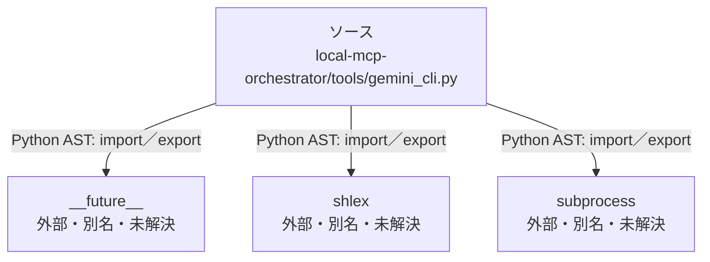

# dependency-map/n-local-mcp-orchestrator-tools-gemini-cli-py-b37374

[解析トップへ戻る](../../README.md)

確認済みファイル: `local-mcp-orchestrator/tools/gemini_cli.py`

解析: Python AST。静的なimport／export参照です。関数の実行順序やHTTP通信は表していません。

宣言: `run`

- `__future__` → 外部・標準ライブラリ・別名など。ローカル対応先は未確定
- `shlex` → 外部・標準ライブラリ・別名など。ローカル対応先は未確定
- `subprocess` → 外部・標準ライブラリ・別名など。ローカル対応先は未確定

## 要素の説明

### n-future-05a733

参照名: `__future__`

ローカルのソース対応先を確定できませんでした。外部ライブラリ、標準ライブラリ、型別名などを区別する追加確認が必要です。

### n-shlex-0d3a6c

参照名: `shlex`

ローカルのソース対応先を確定できませんでした。外部ライブラリ、標準ライブラリ、型別名などを区別する追加確認が必要です。

### n-subprocess-d2d1e1

参照名: `subprocess`

ローカルのソース対応先を確定できませんでした。外部ライブラリ、標準ライブラリ、型別名などを区別する追加確認が必要です。

### source

`local-mcp-orchestrator/tools/gemini_cli.py` の内容を確認しました。

