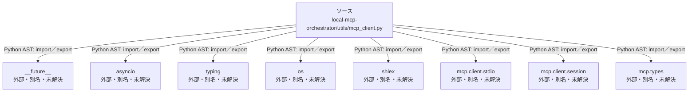

# dependency-map/n-local-mcp-orchestrator-utils-mcp-client-py-254919

[解析トップへ戻る](../../README.md)

確認済みファイル: `local-mcp-orchestrator/utils/mcp_client.py`

解析: Python AST。静的なimport／export参照です。関数の実行順序やHTTP通信は表していません。

宣言: `MCPUnavailable`, `_try_mcp_once`, `ask_via_mcp`

- `__future__` → 外部・標準ライブラリ・別名など。ローカル対応先は未確定
- `asyncio` → 外部・標準ライブラリ・別名など。ローカル対応先は未確定
- `typing` → 外部・標準ライブラリ・別名など。ローカル対応先は未確定
- `os` → 外部・標準ライブラリ・別名など。ローカル対応先は未確定
- `shlex` → 外部・標準ライブラリ・別名など。ローカル対応先は未確定
- `mcp.client.stdio` → 外部・標準ライブラリ・別名など。ローカル対応先は未確定
- `mcp.client.session` → 外部・標準ライブラリ・別名など。ローカル対応先は未確定
- `mcp.types` → 外部・標準ライブラリ・別名など。ローカル対応先は未確定

## 要素の説明

### n-asyncio-4f5a0f

参照名: `asyncio`

ローカルのソース対応先を確定できませんでした。外部ライブラリ、標準ライブラリ、型別名などを区別する追加確認が必要です。

### n-future-05a733

参照名: `__future__`

ローカルのソース対応先を確定できませんでした。外部ライブラリ、標準ライブラリ、型別名などを区別する追加確認が必要です。

### n-mcp-client-session-f73454

参照名: `mcp.client.session`

ローカルのソース対応先を確定できませんでした。外部ライブラリ、標準ライブラリ、型別名などを区別する追加確認が必要です。

### n-mcp-client-stdio-39eead

参照名: `mcp.client.stdio`

ローカルのソース対応先を確定できませんでした。外部ライブラリ、標準ライブラリ、型別名などを区別する追加確認が必要です。

### n-mcp-types-c62d06

参照名: `mcp.types`

ローカルのソース対応先を確定できませんでした。外部ライブラリ、標準ライブラリ、型別名などを区別する追加確認が必要です。

### n-os-999a34

参照名: `os`

ローカルのソース対応先を確定できませんでした。外部ライブラリ、標準ライブラリ、型別名などを区別する追加確認が必要です。

### n-shlex-0d3a6c

参照名: `shlex`

ローカルのソース対応先を確定できませんでした。外部ライブラリ、標準ライブラリ、型別名などを区別する追加確認が必要です。

### n-typing-02d7d3

参照名: `typing`

ローカルのソース対応先を確定できませんでした。外部ライブラリ、標準ライブラリ、型別名などを区別する追加確認が必要です。

### source

`local-mcp-orchestrator/utils/mcp_client.py` の内容を確認しました。

