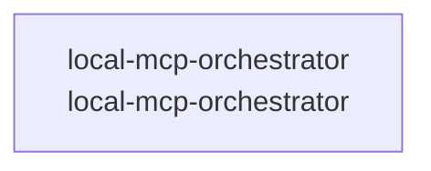

# overall-architecture

[解析トップへ戻る](../README.md)

# local-mcp-orchestrator

ローカルMCPクライアントとGemini CLI呼び出しなどを持つオーケストレーター。

この図はリポジトリ内の構成です。コードを実行した結果やサービス間の通信保証ではありません。

## 対象と根拠

対象: https://github.com/FORIFOR/local-mcp-orchestrator

取得ブランチ: `main`

Git tree SHA: `cefa77a42b636b338ddabce6b05eeed214acb8a0`

ファイル一覧: 65件。内容確認: 2件。全ファイルの意味解析ではありません。

## 解析の制約

実コードの取得は入口、マニフェスト、直接参照先を中心とする初回解析です。動的ロード、実行時設定、別リポジトリとの接続、ローカル未コミット変更は未確認です。

## 確認が必要な点

構成図の配置関係と、実際の通信・呼び出し関係を区別してください。README上の機能や精度の記述は動作検証済みという意味ではありません。

## 追加解析

未読の中核モジュールから処理順序・データ保存・状態遷移を追加解析する。実行環境で通信先と機能フラグを照合する。

## 補足

2026-10-11の初回解析スナップショットです。現在のコードとの差分や実行環境は追加確認が必要です。

## 要素の説明

### n-local-mcp-orchestrator-dd539a

確認したパス: `local-mcp-orchestrator`。配下の登録ファイルは62件。

- `local-mcp-orchestrator/.gpt_code_history`（一覧のみ）
- `local-mcp-orchestrator/README.md`（一覧のみ）
- `local-mcp-orchestrator/agent.py`（一覧のみ）
- `local-mcp-orchestrator/cli_chat.py`（一覧のみ）
- `local-mcp-orchestrator/gpt-code`（一覧のみ）
- `local-mcp-orchestrator/gpt_code_agent.py`（一覧のみ）
- `local-mcp-orchestrator/mcp-server.yaml`（一覧のみ）
- `local-mcp-orchestrator/model.gguf`（一覧のみ）
- `local-mcp-orchestrator/models/gpt-oss-20b-MXFP4.gguf`（一覧のみ）
- `local-mcp-orchestrator/requirements.txt`（一覧のみ）
- `local-mcp-orchestrator/scripts/setup-codex-websearch.sh`（一覧のみ）
- `local-mcp-orchestrator/src/adder.py`（一覧のみ）
- `local-mcp-orchestrator/src/calc.py`（一覧のみ）
- `local-mcp-orchestrator/src/cli_tool.py`（一覧のみ）
- `local-mcp-orchestrator/symlinks.sh`（一覧のみ）
- `local-mcp-orchestrator/tests/test_adder.py`（一覧のみ）
- `local-mcp-orchestrator/tests/test_calc.py`（一覧のみ）
- `local-mcp-orchestrator/tests/test_cli_impact_alias.py`（一覧のみ）
- `local-mcp-orchestrator/tests/test_cli_tool.py`（一覧のみ）
- `local-mcp-orchestrator/tests/test_impact_scan.py`（一覧のみ）
- `local-mcp-orchestrator/tests/test_patch_flow.py`（一覧のみ）
- `local-mcp-orchestrator/tmp/demo_patch.txt`（一覧のみ）
- `local-mcp-orchestrator/tmp/e2e_apply.txt`（一覧のみ）
- `local-mcp-orchestrator/tmp/e2e_apply_run.txt`（一覧のみ）
- `local-mcp-orchestrator/tmp/e2e_conflict.txt`（一覧のみ）
- `local-mcp-orchestrator/tmp/e2e_crlf.txt`（一覧のみ）
- `local-mcp-orchestrator/tmp/e2e_repr.txt`（一覧のみ）
- `local-mcp-orchestrator/tmp/e2e_repr_run.txt`（一覧のみ）
- `local-mcp-orchestrator/tmp/e2e_repr_run2.txt`（一覧のみ）
- `local-mcp-orchestrator/tmp/e2e_smoke_crlf.txt`（一覧のみ）
- `local-mcp-orchestrator/tmp/e2e_smoke_exec.sh`（一覧のみ）
- `local-mcp-orchestrator/tmp/e2e_tool.sh`（一覧のみ）
- `local-mcp-orchestrator/tmp/lock.txt`（一覧のみ）
- `local-mcp-orchestrator/tmp/smoke.txt`（一覧のみ）
- `local-mcp-orchestrator/tmp/smoke_crlf.txt`（一覧のみ）

[詳細な図と説明を見る](n-local-mcp-orchestrator-dd539a/README.md)

