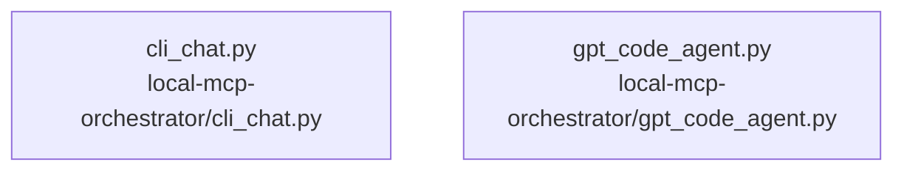

# overall-architecture/n-local-mcp-orchestrator-dd539a/group-2

[解析トップへ戻る](../../../README.md)

このグループは表示用の区切りです。独立した実行モジュールではありません。

## 要素の説明

### n-local-mcp-orchestrator-cli-chat-py-7fe7a3

実在パス: `local-mcp-orchestrator/cli_chat.py`。1ファイル。

- `local-mcp-orchestrator/cli_chat.py`

### n-local-mcp-orchestrator-gpt-code-agent-py-702a86

実在パス: `local-mcp-orchestrator/gpt_code_agent.py`。1ファイル。

- `local-mcp-orchestrator/gpt_code_agent.py`

